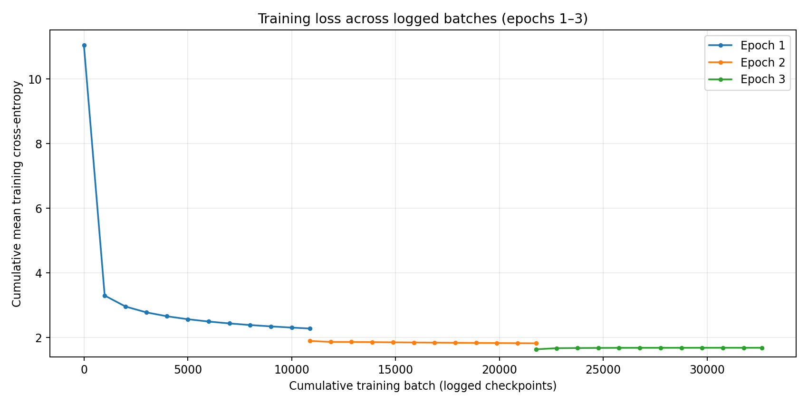
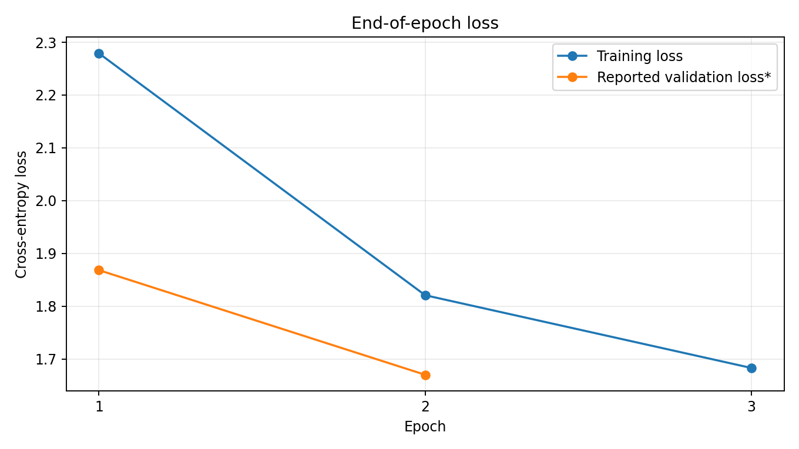

# Mistral-Inspired Transformer from Scratch | PyTorch

A research-oriented implementation and training study of a **Mistral-inspired decoder-only language model**, built from scratch in PyTorch. The notebook implements **Grouped-Query Attention (GQA), Rotary Positional Embeddings (RoPE), causal Sliding-Window Attention, RMSNorm, and KV-cache-based text generation**, and trains the model on **TinyStories**.

> **Scope:** This is a custom Mistral-inspired Transformer **trained from random initialization**, not the official Mistral 7B model or its pretrained weights. The notebook's `Mistral7B` class name does not imply 7 billion parameters.

## Project at a glance

| Item | Details |
|---|---|
| Task | Autoregressive, next-token language modeling |
| Framework | PyTorch |
| Dataset | TinyStories Narrative Classification (Kaggle CSV) |
| Hardware | Kaggle, **2 × NVIDIA Tesla T4 GPUs (15 GB VRAM each)** |
| Training time | Approximately **8 hours**, as reported for the experiment |
| Multi-GPU training | PyTorch `DataParallel` |
| Initial batch loss reported | **11.5879** (author-reported; no exact batch provided in excerpt) |
| Later loss reported | **1.5606** (author-reported; batch/epoch not specified in excerpt) |
| Logged complete epochs | 2 training + evaluation; epoch 3 training completed, evaluation not supplied |
| Saved checkpoint | `best_model.pt` (in the Kaggle working directory) |

**Model artifacts:** [Hugging Face — reda12Malki/Mistral7B](https://huggingface.co/reda12Malki/Mistral7B/tree/main)

The values **11.5879 → 1.5606** summarize the author's reported improvement and are **not** plotted as a continuous loss curve, because their exact step locations were not supplied. The charts below plot only the timestamped/batch-identified observations in the provided log.

## Architecture

```text
Input token IDs
    ↓
Token embedding (768)
    ↓
32 × Decoder Transformer Block
    ├── RMSNorm → GQA + RoPE + causal sliding-window attention → residual
    └── RMSNorm → Linear → SiLU → Linear → residual
    ↓
Final RMSNorm
    ↓
Vocabulary projection → next-token logits
```

| Hyperparameter | Notebook configuration |
|---|---:|
| Layers | 32 |
| Hidden size | 768 |
| Query heads | 12 |
| Key/value heads | 4 |
| Per-head dimension | 64 |
| Attention window | 64 tokens |
| Training context | 128 tokens |
| Feed-forward intermediate width | 3,072 |
| Tokenizer | GPT-2, 50,257 vocabulary size |
| Train batch size | 24 |
| Learning rate | 3 × 10⁻⁴ |
| Weight decay | 0.1 |
| Optimizer | AdamW |
| Training technique | Float16 autocast and gradient scaling |
| Configured training epochs | 7 |

**Implementation detail:** The FFN here is `Linear → SiLU → Linear`, not the gated SwiGLU sublayer of the released Mistral model. The KV cache is implemented explicitly for autoregressive decoding.

## Training results

The experiment optimizes next-token cross-entropy. Loss decreased substantially during training. Logged epoch averages and evaluation values available in the submitted run are:

| Epoch | Mean training loss | Reported evaluation loss* | Reported perplexity* | Epoch elapsed time |
|---|---:|---:|---:|---:|
| 1 | 2.2791 | 1.8684 | 6.48 | 178.8 min |
| 2 | 1.8209 | 1.6702 | 5.31 | 178.8 min |
| 3 | 1.6831 | Not provided | Not provided | Training: 124.8 min |

* **Evaluation caveat:** The uploaded notebook currently creates `validation_dataset` but passes **the training `dataset`** to `val_loader`. Thus the displayed evaluation loss and perplexity **do not represent independent held-out validation**. They should be regarded as reported evaluation-on-training-data metrics until the loader is corrected and the model re-evaluated. See [Known limitations](#known-limitations-and-reproducibility).

### Training-loss curve — logged batches



The points are **cumulative mean training losses** printed at batches 1, 1000, 2000, …, 10000, and the end of each epoch—not instantaneous per-batch losses. Consequently, a small rise early in epoch 3 is not necessarily divergence. The log's first shown loss is 11.0444 at epoch 1/batch 1; the separately reported 11.5879 is not included in the plotted series.

### Epoch-level train and reported evaluation loss



This chart includes only epochs 1–2 for reported evaluation loss and deliberately omits the unavailable epoch-3 evaluation metric. See caveat above.

### Sample generated story

The following is an actual example included in the supplied **epoch-2 training output** (excerpt presented as logged):

> Once upon a time there was a girl named Jane. Jane was three years old and loved to play.
>
> One day, Jane's mom took her to the park. On the way there, she saw lots of kids playing. She wanted to join them, but they looked too messy.
>
> So Jane asked

The text demonstrates **basic local coherence, sentence structure, and a consistent short-story setting**. This is a qualitative sample, **not** a benchmark of factual reasoning or general language understanding. Output quality can vary by prompt and random sampling.

## Setup and execution workflow

### 1. Prerequisites

- Python **3.10+** recommended; JupyterLab or Kaggle Notebooks
- A CUDA-capable GPU is strongly recommended for the current model; **Kaggle's 2 × T4 setup** was used in the reported run
- Access to the Kaggle **TinyStories Narrative Classification** dataset or locally downloaded `train.csv` and `validation.csv`
- Adequate disk and system memory for tokenized data and checkpoints

Install the Python packages in a virtual environment (for local execution):

```bash
python -m venv .venv
# Windows PowerShell:
.venv\Scripts\Activate.ps1
# Linux/macOS:
# source .venv/bin/activate
python -m pip install --upgrade pip
pip install torch transformers pandas numpy psutil tqdm jupyter
```

**GPU note:** Install a CUDA-enabled PyTorch build compatible with your GPU and drivers using the selector at <https://pytorch.org/get-started/locally/>. Kaggle environments typically include PyTorch and many dependencies already.

### 2. Obtain the project and dataset

```bash
git clone https://github.com/Reda123-oss/Mistral-Architecture-From-Scratch-plus-Training.git
cd Mistral-Architecture-From-Scratch-plus-Training
jupyter lab
```

On Kaggle, create a notebook with **GPU acceleration**, attach the TinyStories dataset, then upload/open `mistral-7b.ipynb` (or the documented notebook filename in this repository).

The notebook currently loads:

```python
train_path = "/kaggle/input/datasets/thedevastator/tinystories-narrative-classification/train.csv"
validation_path = "/kaggle/input/datasets/thedevastator/tinystories-narrative-classification/validation.csv"
```

If running outside Kaggle, **change the two `pd.read_csv(...)` paths** to your local files. The notebook currently samples up to 150,000 training rows and 5,000 validation rows.

### 3. Run the notebook in order

1. **Imports and hardware check:** Initialize PyTorch, inspect CUDA availability and GPU devices.
2. **Build the model:** Define embeddings, RMSNorm, RoPE, GQA/sliding-window attention, FFN, decoder blocks, and `Mistral7B`.
3. **Load and tokenize data:** Read TinyStories, remove null text rows, tokenize with GPT-2, and construct shifted input/target sequences.
4. **Create DataLoaders:** Configure context length, batch size, prefetch workers, and separate training/evaluation loaders.
5. **Initialize optimizer:** Construct the model and AdamW; wrap with `DataParallel` only when multiple GPUs are available.
6. **Train and inspect logs:** Execute `train_model(...)` (configured for 7 epochs) and monitor training/evaluation loss. The best reported checkpoint is saved as `best_model.pt`.
7. **Generate sample text:** Use the notebook's `generate(...)` helper with a prompt such as `Once upon a time`.

**Before relying on validation scores, correct this issue in the notebook:**

```python
# Existing validation DataLoader mistakenly uses dataset (training data).
val_loader = DataLoader(
    validation_dataset,  # Use actual held-out data
    batch_size=20,
    shuffle=False,
    pin_memory=True,
    num_workers=4,
    prefetch_factor=2,
    persistent_workers=True,
)
```

For full reproducibility, also review the final-sample slicing behavior of `TextDataset` and ensure every `x` and shifted `y` have the same context length.

### 4. Load model artifacts / inference

The notebook saves a PyTorch checkpoint dictionary containing `model_state_dict`, `optimizer_state_dict`, `epoch`, `val_loss`, and `history`.

For evaluation or text generation, **run the model-definition cells first**, instantiate the same architecture, and restore the weights:

```python
checkpoint = torch.load("best_model.pt", map_location="cpu", weights_only=True)
model.load_state_dict(checkpoint["model_state_dict"])
model = model.to(device)
model.eval()

# After running the notebook's generate(...) definition:
print(generate(model, tokenizer, prompt="Once upon a time", max_new_tokens=60))
```

Here `model` should be the **unwrapped architecture**; if it is currently wrapped by `DataParallel`, load through `model.module.load_state_dict(...)` instead. If your installed PyTorch version does not support `weights_only`, update PyTorch and load only trusted checkpoints. For externally downloaded weights, confirm the artifact's structure and compatibility before loading.

## Known limitations and reproducibility

- **Evaluation leakage:** The notebook's `val_loader` currently uses the training dataset, so the reported evaluation loss/PPL are **not held-out measurements**. Correct and rerun evaluation for defensible generalization results.
- **Final dataset sample:** `TextDataset` can expose mismatched input and target lengths near the end of the token stream; verify the final sample and sequence length before rerunning training.
- **Loss-reporting scope:** The user-reported endpoint `1.5606` is not tied to a batch or completed epoch in the supplied log. No trajectory or validation number is inferred for it.
- **Run duration:** The reported ~8-hour Kaggle run is approximate. Provided logs include complete epoch timing for epochs 1–2 and the training portion of epoch 3; they do not document seven completed epochs.
- **Architectural fidelity:** This is a learning/research implementation inspired by Mistral techniques, not an exact reimplementation of the published 7B model.
- **Hardware:** Two 15 GB GPUs provide **15 GB per device**, not a shared 30 GB memory pool. `DataParallel` replicates model parameters and is not identical to distributed data parallelism.
- **Stochastic sampling:** Generated samples depend on model state and random sampling; individual examples do not establish a standardized benchmark.

## Further experiments

Potential extensions include corrected held-out evaluation, deterministic seeds and version pinning, rigorous perplexity and sampling comparisons, gradient/throughput profiling, and ablations for window size, GQA group count, and KV cache efficiency.

## References

- Jiang et al., [*Mistral 7B*](https://arxiv.org/abs/2310.06825), 2023.
- Ainslie et al., [*GQA: Training Generalized Multi-Query Transformer Models from Multi-Head Checkpoints*](https://arxiv.org/abs/2305.13245), 2023.
- Su et al., [*RoFormer: Enhanced Transformer with Rotary Position Embedding*](https://arxiv.org/abs/2104.09864), 2021.
- Zhang and Sennrich, [*Root Mean Square Layer Normalization*](https://arxiv.org/abs/1910.07467), 2019.
- Eldan and Li, [*TinyStories: How Small Can Language Models Be and Still Speak Coherent English?*](https://arxiv.org/abs/2305.07759), 2023.

---

**Project status:** Research and educational prototype; training results reported above are experimental observations, not independently verified benchmarks.
